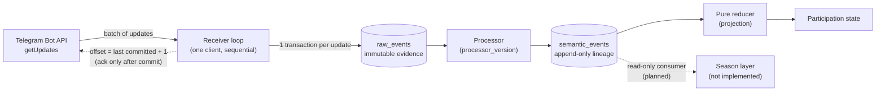

# Witness Core V1 — Architecture

> **Public documentation — owner-authorized release (2026-11-01). Evidence limitations disclosed.**
>
> **Sources:**
> - the frozen Witness Core Hardening Spec V1 rev47 and the T-2 Core Cutover Execution Spec v1.2 (the design);
> - migrations 011b and 011e (the deployed database controls);
> - production records (what ran).
>
> **Labels.** Statements about mechanisms are labelled:
> - **Specified** — the design requires it;
> - **Deployed** — the records show it in place;
> - **Verified** — a recorded check passed.
>
> Section 5 of [IMPLEMENTATION_STATUS.md](IMPLEMENTATION_STATUS.md) explains how far each verification was examined.

---

## 1. Layers and boundary (specified)

**Specified (rev47):**
- `raw_events` holds the unchangeable source evidence.
- `semantic_events` is an append-only derivation, tied to a `processor_version`.
- The projection is a fold of a pure reducer over the active lineage.
- Witness records facts and provenance. The projection and the Season layer interpret them.
- No rule about qualification, business deduplication or grace windows lives in Core.

## 2. Ingestion

**Specified (P3, P12, P13, P15; TC-1 layer L1):**
- **One receiver loop.** The bot polls Telegram with `getUpdates`. One receiver loop with one database client handles each batch in ascending `update_id` order.
- **Store before anything else.** Every update returned by `getUpdates` is stored as a raw record before any side effect (P12). Commands are stored as events, not handled as messages.
- **One transaction per update.** Each update commits in its own transaction before the next one starts (P13).
- **Stop on failure.** The batch stops at the first failed commit.
- **Acknowledge only what is stored.** The next `offset` is the last committed `update_id + 1`, so Telegram acknowledgement never runs ahead of storage.
- **Nothing can block the raw write.** No operation that runs before the raw write may prevent it (P15).

**Specified (DEP-7, decided by SQUNO on 2026-10-06).** On a graceful stop, the service confirms its last committed update to Telegram (`ACK_CONFIRMED`). If the stop cannot confirm, it counts as an acknowledgement failure.

**Specified (rev47).** A database outage pauses intake. Telegram keeps undelivered updates for about 24 hours, so an outage longer than that loses data. The design states this openly instead of hiding it.

**Verified (project records):**
- P12 batch accounting held on 213 live batches at the Phase 3 gate (threshold 30).
- TC-1 L1, a static review of the ordering semantics, was performed by KORKI. See [T2_CLOSURE.md](T2_CLOSURE.md).

## 3. Raw evidence

**Specified (P1, P2, P3).** **Deployed:** migration 011b at cutover step 3.7, hardened by 011e on 2026-10-12.

- **Identity.** A raw record's identity is `(bot_id, update_id)`, enforced by a unique index (011b).
- **Three separate times, never conflated:**
  - `source_event_at` — the time at the source, taken from the payload. For an edit it is the edit time. It is a generated column.
  - `observed_at` — the moment the `getUpdates` response arrived. It is one value per batch, with no default.
  - `persisted_at` — the storage time. It is never an input to any rule.
- **No ordering rule between the times.** Clock skew between Telegram and the server is real, so the design does **not** require `observed_at ≥ source_event_at`.
- **Legacy rows.** Rows from before the cutover carry an explicit `legacy_unknown` observation source instead of an invented time (011b).
- **Immutability is enforced by the database, not by code discipline.** Migration 011e:
  - adds triggers that reject `UPDATE`, `DELETE` and `TRUNCATE`;
  - makes the foreign key from derived to raw rows `ON DELETE RESTRICT`;
  - moves ownership of the tables to a separate non-login owner role. The service role can only read and insert evidence.

## 4. Semantic processing

**Specified (P3–P6, P11, P14):**
- **Derived-event identity.** A derived event's identity is `(raw identity, processor_version, derivation_ordinal)`. It also carries a semantic key and a content hash. Conflicting derivations are recorded in a violations table, not silently dropped.
- **`processor_version`** is the hash of the transformation's code closure. A new version creates a **new lineage**. Replaying a lineage compares; it never rewrites.
- **Derivation fixes:**
  - Edits link to their originals.
  - A message at a forum-topic root is not a reply.
  - Membership changes are fully typed.
- **P11.** A derivation depends only on the raw record being processed. "First counts" rules belong to the projection or the Season layer.

**Deployed.** The production build's `processor_version` is `88eebb28…`. It is recorded in the Phase 2 pass packs and in production checkpoints.

## 5. State reconstruction, replay and determinism

**Specified (P7):**
- The projection is a fold of a pure reducer over the semantic events of the active lineage, in canonical order `(update_id, derivation_ordinal)`.
- The reducer performs no I/O and reads neither the clock nor randomness.
- The projection must be identical across restarts.

**Verified (project records).** Gate restarts at Phase 3 and at Phase 4 step 4.3 left the projection unchanged at the same position (P7 checkpoints).

**Reproduction of legacy history (verified, production pack examined):**
- On 6 October 2026, the frozen *pre-hardening* processor replayed legacy Segment C: 18,128 raw rows.
- It produced 26,439 derived events. The legacy database constraints stored 26,436 of them, exactly as production had. Expected and actual hashes matched.
- **What this proves.** The history is reproducible. It does not prove the history was correct: 3 events were silently dropped by the old constraints (see [LIMITATIONS.md](LIMITATIONS.md) §4).
- **This is not a V1 replay.** The full-history replay of the hardened V1 build was step 4.7 of Phase 4. It was completed in the 1 November continuation, and Stage G confirmed it as PASS (operator transcript). The replay output itself was not examined.

**Comparison vs correction.** A replay can **detect** a difference between lineages. It never edits past rows. A correction means deriving a new lineage under a new `processor_version`.

**Recorded limitation.** A replay comparison alone does not prove fold equality. Fold equality is shown separately, by reducer checkpoints at the same position.

## 6. Database integrity

**Deployed (011e, applied 2026-10-12 at Phase 4 step 4.3):**
- **Run conditions.** 011e runs as one superuser transaction. The Phase 4 procedure applies it only after TC-1 has passed. 011e itself refuses to run unless the caller is a superuser and 011d is recorded in the ledger.
- **Fail-closed pre-checks.** It checks for null identity fields and for post-cutover rows marked `legacy_unknown`.
- **Constraints.** It makes identity columns `NOT NULL`, drops their defaults, and adds a check that ties `observed_at` to the observation source.
- **Append-only triggers.** It installs append-only triggers on every table except a short list of projection and runtime tables. Unclassified tables are protected by default.
- **Owner role.** It creates a non-login owner role that owns every object.
- **Permissions.** It revokes all privileges from the service login role, then re-grants a frozen permission matrix:
  - read and insert only on evidence tables;
  - read on registries;
  - only the listed changes on projection and runtime tables.

**Verified (project records):**
- **P1, step 4.4.** After 011e was committed at step 4.3, the production catalog matched an isolated database built by the same migration.
- **P9, step 4.5.** A schema dump of production matched migrations 001–011e applied to an empty database. The ledger records 011a–011e with SHA256. Earlier migrations are entered as applied before the ledger existed. Numbers 005 and 008 never had files.

**Rollback boundary (specified):**
- **Data rollback.** Not possible after 011e.
- **Rollback to the frozen pre-hardening build (R1).** Refused after 011e.
- **Code rollback.** Still possible, but only to builds made after the cutover.

## 7. Recovery

**Specified:**
- **Redelivery is harmless.** A crash between commit and acknowledgement causes redelivery, and the raw identity makes that harmless (P3).
- **Rollback (R1).** R1 never restores the database and never deletes a V1 row. Any rollback puts T-2 on HOLD.
- **Frozen-code window.** From cutover step 3.7 until the first confirmed graceful stop, the old frozen code must never be started (DEP-7 boundary).

**Verified (project records).** The gate restarts ended `ACK_CONFIRMED` 2/2.

**Deployed (observed).** The service runs as a system service unit. The T-2 operator checks treated its main process ID and its restart count as stop conditions.

**Not established:** general process supervision. See [LIMITATIONS.md](LIMITATIONS.md) §9.

## 8. Reporting and verification

**Logs are not evidence (P10, specified):**
- Evidence lives in the database.
- Logs must not hold full payloads, and they must be rotated with restricted permissions.
- The Phase 4 base run went to HOLD at this step (4.6): the log-control script did not verify (13 October production diagnostic). The builder diagnosed a log-file permission precondition in the kit (builder notes).
- The Phase 4 continuation of 1 November 2026 applied a corrected log-rotation configuration as its only production write. Stage G's re-run of the continuation verifier passed (operator transcript).

**Evidence packs.** Each T-2 phase run writes one sealed evidence pack:
- read-only file mode;
- a `SHA256SUMS` file;
- a `GATE.txt` result.

Later packs bind earlier ones by hash. A few production reads produced no pack; these are listed in [EVIDENCE_INDEX.md](EVIDENCE_INDEX.md).

**Public versus internal.** Packs, transcripts and database contents stay private. Public documents carry only summaries and identities.

## 9. Architectural leadership and design accountability

| Act | Party | Evidence |
| --- | --- | --- |
| Architecture and boundaries (Core vs projection vs Season; raw vs semantic; lineage model) | Specified in rev47, bylined to SQUNO. Drafting not attributed (see below). | rev47 |
| rev47 freeze (2026-09-26) | The freeze is stated in the revision itself. The preceding rev42 "awaits SQUNO's acceptance", so SQUNO's acceptance is inferred; no separate acceptance record was examined. | rev42, rev47 |
| D1–D6 | The spec text gives the recommendations (drafting not attributed). SQUNO decided D3 (decision v2, `CLOSED_WITH_CUTOVER_DELTA`, 2026-10-06; see [T2_CLOSURE.md](T2_CLOSURE.md) §11). SQUNO decided D4–D6 on 2026-10-06 (DEP-1 to DEP-3). For D1 and D2, rev47 reserves the decision for SQUNO and their outcomes are in T-2 v1.2, which SQUNO froze. No separate decision record names the decider. | rev47 p24; T-2 spec; D3 decision v2 |
| T-2 decisions DEP-7 and DEP-8 (2026-10-06), DEP-11 values, DEP-11a amendment (2026-10-11/12) | **SQUNO**. The DEP-11a mechanism was designed and implemented by the AI builder and reviewed by KORKI (builder notes). | T-2 spec (DEP-7, DEP-8, DEP-11); builder notes and the closure record's hash binding `272ed35b…` (DEP-11a; the amendment file itself was not examined) |
| Freezes: T-2 v1.2 (2026-10-06), S0 (2026-10-07) | **SQUNO** (T-2 lifecycle line); S0 run under SQUNO's authorization | T-2 spec; S0 record |
| Hardened application code, migrations, tests, kits, verifiers | AI builder (Claude / ASTER) | Builder notes |
| Review | KORKI (AI) from 12 October; unnamed separate reviewer agents before that | Review records |
| Production execution | Project operator under SQUNO's written authorization (builder notes name SQUNO) | Authorization records |

**Specification drafting.** The specifications are bylined to SQUNO. Their text is written in the first person and refers to SQUNO as the decider ("requires SQUNO's decision"). The records do not establish who drafted the text, whether by hand or with AI assistance. These documents therefore attribute the architectural **decisions and approvals** to SQUNO, and do not attribute the drafting.

**Recorded alternatives:**
- D4, D5 and D6 each had options A and B; B was chosen.
- DEP-7 took option (a), with (b)'s boundary.
- TC-1's original threshold could not be reached, so DEP-11a replaced it ([T2_CLOSURE.md](T2_CLOSURE.md) §10).
- P8 historical parity was moved from Phase 1 to an offline S0 check.

Architectural leadership is a technical project role. It does not imply any corporate office.
